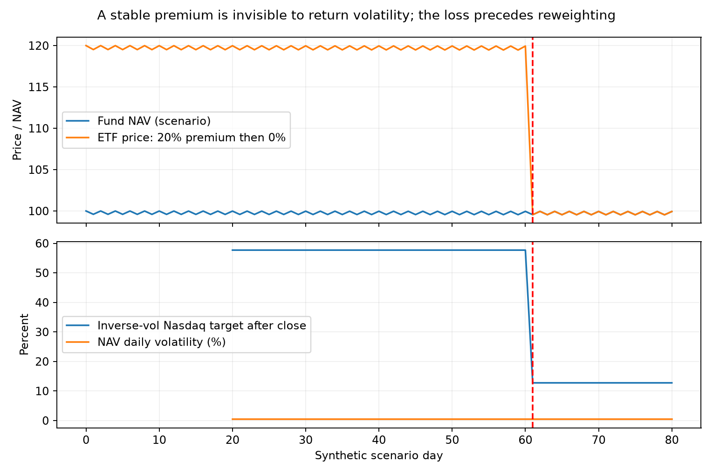

> **分红会计口径更新（2026-10-04）**：本文及原CSV保留为旧研究口径。510300加法前复权不能代替原始份额、除息应收和现金到账账本，也可能改变20日逆波动权重。优先采用[分红修正报告](etf-dividend-valuation-2026-10-04-review.md)的相同费用比较；本文原文已逐字节保存在新输出的legacy_notes目录。两组合在已核查事件下不受510300修正影响；境内标普500仍有事件完整性边界。此更新不关闭BTC/多资产此前两项交付问题。

# 境内场内ETF与5万元试行：2026-10-04

本次是研究和实施草案，没有下单、接入券商或改变原研究文件。使用 `xquant-strategy-review` 流程，先读时序修正与独立复核，再复用冻结数据和调仓日历。原三组合、两组合与SPY人民币定投结果保留。本次只补投资工具、价格会计和小账户执行层，不重跑BTC或多资产。它们仍有详细报告执行措辞、包外依赖两项旧交付问题，不能称整体交付已完成。

**结论：5万元、万分之一佣金且没有最低5元收费，具备研究中的整手和成本可行性；完整组合是否适合立即买入，还取决于海外ETF溢价和可得估值。三组合是较分散的试行候选，两组合是较集中的候选，境内标普500也有可用工具。三者都不能凭旧回测直接满仓试行。目前先做报价与估值记录更合适，海外部分不满足条件就留现金。** 50,000元是400,000元的12.5%，不是风险很小的保证；剩余350,000元的用途和风险未知。

下文用“历史事实”“研究假设”“前瞻建议”区分证据。金额结果是研究账户或诊断，不是券商已实现收入，不把历史年化当作未来预测。

## 1. 实际产品：先比较能不能低成本买到，再比较年费

**历史事实。** 本次核查九只场内ETF，不是全市场穷尽清单。基金成立/上市、管理费/托管费来自注明日期的法律文件；行情和净值快照来自两家数据提供者，不能冒充交易所实时验证。费率表只列主要年费用，其他运作费用、基金内部交易与税负另见法律文件；这些已经反映在基金净值中，不能在市价回测上再重复扣一次。

| 资产 | 代码及管理人 | 成立 / 上市 | 管理费＋托管费/年 | 9月30日成交额 | 留存完整买卖价差 | 1手参考买入金额 |
|---|---|---|---|---:|---:|
| 沪深300 | 510300 华泰柏瑞 | 2012-05-04 / 05-28 | 0.15%＋0.05% | 21.96亿元 | 2.26bps | 443.30元 |
| 沪深300 | 510310 易方达 | 2013-03-06 / 03-25 | 0.15%＋0.05% | 13.52亿元 | 4.64bps | 430.70元 |
| 纳指100 | 513100 国泰 | 2013-04-25 / 05-15 | 0.60%＋0.20% | 5.97亿元 | 4.25bps | 235.30元 |
| 纳指100 | 513300 华夏 | 2020-10-22 / 11-05 | 0.60%＋0.20% | 5.09亿元 | 3.55bps | 281.90元 |
| 黄金 | 518880 华安 | 2013-07-18 / 07-29 | 0.50%＋0.10% | 26.95亿元 | 1.16bps | 863.40元 |
| 黄金 | 518800 国泰 | 2013-07-18 / 07-29 | 0.50%＋0.10% | 4.03亿元 | 1.10bps | 905.70元 |
| 标普500 | 513500 博时 | 2013-12-05 / 2014-01-15 | 0.60%＋0.20% | 2.68亿元 | 3.72bps | 268.80元 |
| 标普500 | 159655 华夏 | 2022-10-12 / 10-25 | 0.60%＋0.15% | 1.34亿元 | 4.97bps | 201.30元 |
| 标普500 | 159612 国泰 | 2022-05-09 / 05-20 | 0.60%＋0.15% | 0.30亿元 | 4.82bps | 207.60元 |

费率来源：[510300降费公告，2024-11-22生效](https://www.sse.com.cn/disclosure/fund/announcement/c/new/2024-11-20/510300_20241120_FOBE.pdf)、[510310概要2025-11](https://www.sse.com.cn/disclosure/fund/announcement/c/new/2025-11-18/510310_20251118_W6BU.pdf)、[513100概要2025-03](https://st.gtfund.com/pis/www/CN_50010000_513100_FA010080_20250001_513100_20250321_090000_01.pdf)、[513300概要2025-05](https://www.sse.com.cn/disclosure/fund/announcement/c/new/2025-05-30/513300_20250530_MCHU.pdf)、[518880概要2026-03](https://www.sse.com.cn/disclosure/fund/announcement/c/new/2026-03-06/518880_20260306_F316.pdf)、[518800概要2025-10](https://www.sse.com.cn/disclosure/fund/announcement/c/new/2025-10-15/518800_20251015_4RIV.pdf)。标普三只的成立、上市和费用由 [Luna官方核查说明](../../outputs/domestic-etf-small-account-2026-10-04/evidence/sp500_official_audit.md)列出直接来源；其中[513500 2026-06概要](https://www.sse.com.cn/disclosure/fund/announcement/c/new/2026-06-26/513500_20260626_PDT5.pdf)确认托管费0.20%，不能沿用更早的0.25%。这些文件不替代开市前核查是否有后续变更。

报价留存日期为2026-09-30；供应商标记沪市15:34:59、深市16:29附近，本次获取在10月4日晚，**都是收市后快照，不能当作10月4日或下次开市的可成交价差**。完整价差=(卖一−买一)/中点；bps是万分之一。它不是日内最高价减最低价，更不是历史平均价差。表中成交额是当日供应商金额字段，CSV还导出另一源最近60个交易日实际成交金额中位数/最小值，并保留 `Close×成交份额` 代理作对照。原始量以手计乘100，与另一报价源当日份额数相差不足100份，最新收盘价一致；两源当日成交额差最多1元。

**前瞻建议。** 510300、518880保留为原策略的实施候选，有较长存续和本次较活跃的交易记录；510310、518800是备用，不因一个收市快照就切换产品。518800当天买一仅905份，尽管价差窄，盘口深度也要看。纳指和标普ETF均需逐只比较溢价、深度、费用和估值方法，不认为名称相同就没有替换风险。两只较新标普ETF不能拼接到2015年并冒称真实存续。年费差0.05个百分点，在5万元上约25元/年；一次5%溢价多付约2500元，后者更应优先控制。

## 2. 溢价、申购限制和披露时点：本次确证了什么

**历史事实。** 513100在2026-09-23发出较大溢价风险提示，开市停至10:30。[基金公告正文](https://app.cnstock.com/zzb/zgzqb/html/2026-09/23/nw.D110000zgzqb_20260923_4-B025.htm)没有给出可据此计算的精确溢价数字。本次找到了披露正文，未找到这一日的原始PDF。2026-04-09的同类[上交所PDF](https://www.sse.com.cn/disclosure/fund/announcement/c/new/2026-04-09/513100_20260409_GVQZ.pdf)曾说明自2024-11-25起暂停申购；**不能由此断言10月仍暂停**。本次搜索取得的[9月28日申赎清单](https://www.sse.com.cn/disclosure/fund/etflist/detail.shtml?etfClass=33&fundid=513100)显示申赎皆允许、申购总上限250万份、单账户累计50万份、最小申赎50万份，引用净值日期却是9月23日。这一有日期的清单说明状态会变化，也说明净值参考可能跨多日；网页本地下载只有动态页面框架，不能宣称已冻结完整历史清单。

513500有[2026-05-14暂停申购公告](https://www.sse.com.cn/disclosure/fund/announcement/c/new/2026-05-14/513500_20260514_8YVS.pdf)，159655、159612也有官方溢价警示/临停/暂停申赎例证，见专项核查。513500招募说明书查到最小申赎100万份。**一级市场申购限制不等于禁止二级市场买入**：小账户通常买100份整手，不参加几十万至百万份的申赎套利。申购额度/假期/暂停会削弱新增份额供给，买得到并不等于买得合理。其他产品当前清单上限、今日有效状态仍未核实，报告没有把“场内买入”供应商标签当成申购已开放。

**历史事实，但不是即时真实溢价。** 留存收盘价与本次最新取得净值的比值如下：

| 代码 | 成交价日期 / 净值日期 | 收盘价÷最后净值−1 |
|---|---|---:|
| 510300 / 510310 | 9月30日 / 9月30日 | 0.018% / 0.016% |
| 518880 / 518800 | 9月30日 / 9月30日 | 0.060% / 0.118% |
| 513100 / 513300 | 9月30日 / 9月29日 | 15.41% / 11.32% |
| 513500 / 159655 / 159612 | 9月30日 / 9月29日 | 9.85% / 7.46% / 8.15% |

这是原始留存价格和第三方披露净值的**可复算参考比值**，不是成交时已知溢价。净值发布时刻未知；美国标的、汇率和估值截止时刻与中国收盘不同。即使国产资产同日期，净值也通常是收盘后形成，不能用它批准当天早盘买入。海外ETF这些比值和独立的基金风险公告共同提示应谨慎核查，不证明下个交易日仍有相同溢价。

**IOPV与时点。** NAV日期是基金资产估值所属日期；公告日期/精确披露时间是投资者可能取得数据的时间；IOPV是参考估值，有自己的计算基础和更新时间；成交价/买卖盘有报价时刻。四者不能混为一条“当天数据”。[513100招募说明书2025-12](https://www.sse.com.cn/disclosure/fund/announcement/c/new/2025-12-22/513100_20251222_8WHV.pdf)的定义涉及申赎清单与最新人民币美元中间价，不能推断海外股票全天在中国交易时段实时更新；未验证最新版本的完整IOPV刷新链路。[国泰黄金概要](https://www.sse.com.cn/disclosure/fund/announcement/c/new/2025-10-15/518800_20251015_4RIV.pdf)说明参考黄金最新成交价计算IOPV，但仍可能与实时净值不同/计算出错。标普各产品的IOPV方法也需按具体法律文件查，不能照搬A股ETF机制。

**数据缺口。** 没有2015—2026年逐条NAV实际发布时刻/首次可见记录、历史IOPV、历史L1/L2盘口、逐日完整申赎额度及全部临停时刻。本次成功取得9只产品近期20条NAV，但最初过大分页请求返回空数据，失败原文与重试记录均保留。官方PDF部分HTTP下载超时，线上已读来源和取得的文件分别记录，未声称所有法律文件均离线归档。日线时间戳不是精确的首次成交时刻，临停日的日线Open可能是复牌后成交。**不做“历史1%溢价过滤后赚多少”的精确回测；合成情景、会计诊断、未来真实记录分别交付。**

## 3. 原回测包含溢价变化，但分红口径不能直接当真账户

**历史事实。** 原510300/513100/518880是场内成交OHLC，不是基金NAV。因市价本身=基金价值×(1＋溢价)，已经含过去实际发生的ETF溢价涨跌；国内ETF市价也含基金内部费用、人民币计价影响、跟踪误差及供求。不能再额外扣一遍同一段历史溢价收缩损失。它没有独立拆出“指数涨跌/汇率/溢价”贡献，更没有覆盖未来未出现的溢价尾部事件。

新取得未复权价格与原冻结数据核对：513100在2022-01-13一拆五、当日无交易，原数据拆分前价格除5与本次精确拆分价格相同；518880未复权与原价格相同。[513500官方结果](https://www.sse.com.cn/disclosure/fund/announcement/c/new/2022-03-30/513500_20220330_2_VODYJTry.pdf)确认3月29日一拆二、3月30日复牌，本次独立接入该产品原始行情并按精确比例处理。供应商 `forward` 在两只跨境产品拆分前的常数比例与精确1/5、1/2略不同，因此不盲从第二种复权，将拆分比例单独纠正。

510300原 `forward_additive` 有加法前复权问题：2015-01-05原价3.688元，旧价2.889元，比例前复权代理3.007762元。2015年以来，同日收益率差值最大2.83个百分点（2015-07-09）；重新计算20日权重，300目标权重差值在全研究日历最大约6.05个百分点。因为加法扣减改变过去收益率的分母，**后来现金分红的扣减还会改变先前的波动估计**。比例复权的常数缩放在相邻期间会消掉，不能与加法复权混同。原内部重建测试通过只是准确复现该价格口径，不能证明真实分红会计正确。

**研究假设：口径诊断，不是最终纠正后的可得收益。** 固定同一2015-01—2026-09月入金10,000元、141次、累计1,410,000元、20日窗口、原10交易日相位；只分离成本、价格和权重变化。以下末值预扣1bps退出费用，仍是分数份额价格代理。

| 诊断（3组合） | 末值 | 相对前一口径的原因 |
|---|---:|---|
| 旧加法价格/旧权重，原10bps成本 | 405.35万元 | 原定投基线，原文保留 |
| 旧加法价格/旧权重，1bps成本 | 416.41万元 | 单独改为用户佣金条件 |
| 比例分红代理＋精确拆分/旧权重，1bps | 410.37万元 | 单独隔离价格会计影响 |
| 同代理/重算20日权重，1bps | 405.44万元 | 再隔离信号权重影响 |

同成本下，三组合代理口径末值比旧口径少约10.96万元；不能因新1bps末值碰巧接近旧10bps末值就说没有问题。两组合在精确拆分/黄金口径下末值538.70万元，变动几乎为0；删除300后20日逆波动相对配比只取决于纳指和黄金。**三组合历史数字应视为待完成分红会计校正的研究结果，两组合避开这一个具体缺陷，但仍有价格/溢价和样本风险。**

境内513500同入金/1bps、精确拆分、真实国内成交价的代理末值366.03万元、累计净盈利225.03万元、最差低于累计本金约4272元、单位净值最大回撤29.67%；最差36/60期定投结束盈亏为+2.38%/+16.75%。这些是累计盈亏比例，不是年化，也不是未来下限。与原SPY代理的差异不能全归因为溢价：基金费用、基金内分红税负、人民币估值、交易日/时点及假期陈旧报价都不同。513500官方基准是人民币调整后的标普500 **净总回报NTR**，也不能与SPY自动复权的税前再投资代理当作同一收益口径。

为什么仍叫代理：510300的比例复权未逐次对齐官方现金分红发放/再投资规则；没有完整现金分红行动账本。SPY原 `auto_adjust=True, actions=False` 隐含复权和再投资，未模拟个人税负。真实ETF分红可能先成为应收而非可用现金；[510300 2026分红公告](https://www.sse.com.cn/disclosure/fund/announcement/c/new/2026-01-12/510300_20260112_VTCZ.pdf)明确每份0.123元、1月19日除息、1月27日发放。本次短期整手诊断按这段应收/到账时点计算，不预支未到账分红。

原策略仍未涵盖整手、盘口冲击、限价未成交、临停导致延后、涨跌停、真实佣金、零碎份额/分红余额及执行者行为。国内ETF假期沿用旧收盘，不能理解成海外基础资产假期不变或当天一定能退出。国内黄金ETF的市价对NAV偏差之外，还可能有境内黄金与国际金价的价差，ETF溢价门槛不保护全部黄金风险。全部诊断的Q3/Q5、月/年和回撤事件保存在CSV；不将不同风险敞口的回归截距解释为投资能力。

## 4. 逆波动怎样漏掉高溢价风险

**研究假设，可数学复现。** `P=V×(1+p)`，所以ETF收益率=`(1+NAV收益率)×(1+末溢价)/(1+初溢价)−1`。稳定20%的溢价在相邻比值中消掉，ETF百分比波动与NAV相同：**稳定高溢价本身不会自动降低波动，但20日波动也不会告诉你这20%很危险。** 基础资产本身波动较低，或二级市场供求让价格短期平稳，就可能取得较高权重。逆波动没有估值与申赎额度这个风险维度。

本次合成例子固定20%溢价、纳指低短期波动、其他资产更高波动，产生较高纳指权重；第61日溢价突然变0。当天先亏损，收盘后20日波动才上升，下一执行机会才降权。没有趋势退出/杠杆，也不会让损失消失。图及81行生成数据均标明合成，没有假装历史曾按此轨迹发生。现有数据不足以识别这一机制在历史中的发生频率或归因金额。

| 5万元静态压力情景 | 三组合 | 两组合 | 单一标普500 |
|---|---:|---:|---:|
| 海外ETF NAV不动，20%溢价归零 | 约亏2715元 | 约亏4977元 | 约亏8333元 |
| 海外ETF NAV跌30%，同时20%溢价归零 | 约亏6789元 | 约亏12442元 | 约亏20833元 |

按本次重算的末次**目标权重**32.59%/59.72%/100%海外敞口计算，其他资产假设不动、无再平衡/费用，非实际持仓、概率或预测。20%变0造成该ETF跌16.67%，不是跌20%；NAV再跌30%合并为跌41.67%，不是把两数简单相加。若三资产同时跌30%，5万元约亏1.5万元；剩余资产假设不动时相当于40万元总资产的3.75%，不能据此认为试行一定安全。

## 5. 只增加少量执行纪律，不寻找最赚钱阈值

**前瞻建议草案。** 原20日逆波动、无杠杆、无趋势退出、10个共同交易日下一开盘调仓作为R0基线，永久保留。R1只增加买入可得估值/溢价纪律，权重算法与资产池不改变；实际延后、现金偏离必须记录，不能给R1套R0的历史收益。

1. 先核查基金当日有效公告、PCF、IOPV方法；每次保存报价时刻、买卖盘和原始来源。已知NAV必须记录估值日期及可验证的披露/首次见到时间。第一次在10月4日看见的值不能追填成9月30日已知。任何引用在决策之后出现，禁止用来批准订单。
2. 暂定**新增买入溢价上限1%**，是试行风险预算纪律，不是统计最优阈值。若真实公允价值已可靠验证，1%溢价全部归零，对该笔资金的损失约0.99%；最多5万元全部投入，对应约495元的单一溢价损失预算。它不限制市场回撤，也不保证测量误差、滑点或已有溢价敞口损失在500元内。
3. 使用当前公允价值的保守下界与卖一比较：`卖一/下界−1≤1%`才允许新增。下界需要有依据的净值/IOPV时点、最近已完成海外市场与汇率信息；单纯“App显示IOPV”或“最新净值日期”不构成验证。不能建立可靠区间、报价超过60秒、临停/当期明显溢价风险未解除时，暂停新增买入。可额外用最后公开NAV比值做**粗筛**，但不能把它冒称真实溢价；正常市场上涨也可能触发粗筛，应记为估值/时滞导致的暂停。
4. 被暂停部分按资产分别留在人民币现金的虚拟预算桶。新入金只按最新已知目标分配**新增资金**，不把积累的纳指现金重新分配给黄金或A股。不满1手的预算累计；检查通过后按资产桶、可用现金和当前目标补买，避免一次积累金额超过当前目标。每10日正式调仓时按全账户含现金重新计算目标与可交易金额，受限买入仍留现金；不给其他资产重新归一到100%。
5. 已有持仓不因“新增暂停”全部卖掉。正常调仓需要减持超配资产时可以卖；没有趋势止损，也没有承诺靠门槛避免已持有的溢价塌缩。长期高溢价/数据不可靠而造成目标偏差，停止扩仓、单独复核风险预算；若决定退出/换产品，那是另外的风险或工具决策，应登记，不能称原策略自动规则。

参考判断函数、整手预算桶与测试已提供，但这不是自动交易系统，也没有证明海外当前公允区间可持续取得。**当前完整组合的关键前置问题就是这条估值流程；不解决就允许长时间持现金，不能把它包装成满仓三组合/两组合。** 不以旧NAV计算历史买入过滤，更不比较许多阈值选收益冠军。

**等待的代价：研究假设。** 暂停一笔1万元买入，现金按0收益：若NAV涨20%、20%溢价持续，买入者账面涨2000元，等待者错过2000元；若NAV涨20%、20%溢价归零，价格几乎不涨，等待不吃亏；若NAV不变、20%溢价归零，等待避免约1667元价格损失。未来不知道哪种发生，门槛是在限制购买价格风险，不是择时赚钱工具。未验证可得利率，不给暂留现金添加回测利息。

## 6. 5万元账户：整手可以做，月投1000元有明显颗粒度

**历史事实/执行研究假设。** [交易所资料](https://www.sse.com.cn/assortment/fund/etf/question/c/c_20240118_5734754.shtml)规定通常100份一手、价格步长0.001元；[深交所场内指南](https://investor.szse.cn/warning/activities/fundIntroduction/t20210104_584079.html)说明场内基金交易无需印花税。用户确认按万分之一、无最低5元佣金测算；“税率”暂理解为券商佣金，未来以交割单核对其他收费，不添加股票卖出印花税。

以下是按9月30日旧卖一、末次研究目标的**算术演示，不是今天的订单或建议照抄份数**：

| 方案 | 假设全部工具均可买的参考份数 | 买入佣金 | 舍入剩余现金 | 海外新增暂停时的现金 |
|---|---|---:|---:|---:|
| 三组合 | 510300 5100份；513100 6900份；518880 1200份 | 4.92元 | 790元 | 17,028元 |
| 两组合 | 513100 12600份；518880 2300份 | 4.95元 | 489元 | 30,140元 |
| 单一513500 | 18500份 | 4.97元 | 267元 | 50,000元 |

暂停列仍假设其他ETF的估值、价格和盘口通过；不表示认可用黄金代替纳指。三组合参考目标约45.44%/32.59%/21.98%，两组合约59.72%/40.28%；目标是冻结的最近一次信号，不是当前应配置多少。1手黄金约863元，相当于5万元账户1.73个百分点，故不能像分数份额回测那样精确。

月投1000/3000/5000元佣金合计大致0.10/0.30/0.50元（未买部分不收），没有最低收费后无需为了凑5元而等待。按上述三组合目标，月投1000元黄金预算仅220元，可能累计约4个月才够一手；两组合黄金约403元，也可能累计约3个月。3000元三组合黄金预算约659元，仍可能跨月；5000元黄金约1099元通常可买一手。实际权重、价格、已有余款会改变等待，使用按资产预算桶，不抬高其他仓位来“用完现金”。

**研究假设：2026-01-05先入50,000元，2—9月每月入3000元，累计74,000元；原始开盘/收盘、100份整手、1bps佣金、完整价差固定5bps、510300实际分红应收/到账。** 日线Open仅是模型成交代理，不保证能在09:30成交；未加入历史溢价门槛/临停延迟/未成交，不能称真实可得利润。45组诊断只变月投入额、价差情景及调仓频率，不调20日窗口选收益。

| 9个月诊断 | 订单数 | 佣金 | 假设价差成本 | 日收盘单位最大回撤 | 对最近原目标的日偏差最大值 |
|---|---:|---:|---:|---:|---:|
| 三组合，原10日调仓 | 75 | 24.62元 | 61.53元 | −11.71% | 4.53个百分点 |
| 三组合，月度调仓变体 | 27 | 17.75元 | 44.38元 | −12.58% | 19.21个百分点 |
| 两组合，原10日调仓 | 53 | 25.54元 | 63.84元 | −15.34% | 4.54个百分点 |
| 两组合，月度调仓变体 | 18 | 17.14元 | 42.86元 | −17.32% | 26.31个百分点 |
| 513500，月度只买 | 9 | 7.39元 | 18.46元 | −12.88% | 0.51个百分点 |

偏差比较的是原每10日更新目标，包含价格漂移、舍入和月度变体没跟随的信号，**不是纯整手误差**。这段9个月的省费约二三十元，不能证明月度调仓长期更好。完整价差0/5/20bps均保存，0是下界，不认为真实总能零价差成交。50k账户初买佣金约5元，完整价差若5bps，按半价差买入约12.5元，若20bps约50元；分红/基金年费不重复扣。原频率在本次佣金条件下有成本可行性，是否能按时认真执行才是主要门槛。

同一诊断下，三组合/两组合/513500账户低于累计本金的最大账面金额约2911/3484/6538元，均在2026-03-23、累计入金56,000元时；未扣假想退出成本。它与“单位从前高跌了多少”是两种问题，且这9个月远不足以限定未来最坏亏损。最近60个交易日实际成交额中位数，原三只约39.49/3.20/40.38亿元，三只标普产品约3.15/1.11/0.29亿元；小额成交一般不是总成交量的瓶颈，但时段盘口、临停和购买价格仍需要检查。

**前瞻建议。** 初期保留10日审查/调仓计划和20日信号；当天开盘无法取得有效估值或遇停牌，就记录延后，以后可用报价重新检查限价，不能填回原开盘价。使用限价单，报价不足/涨跌停/深度差不追单，下一可执行窗口重新计算可用资金、已有持仓与已知目标；卖出可用款到账/可交易状态以券商为准，不预支分红或未成交卖单。若人工无法每两周审核，则先做另一套固定权重或月度实施研究，不能称它已继承原绩效。

## 7. 试行步骤和何时增加投入

**前瞻建议，尚未开始。** 三种方案选一套合计5万元额度作试行，其余保持模拟比较，避免变成各投5万元共15万元。第一次可以先做100份级的操作验证，然后按最新信号、预算桶、溢价门槛分批达到额度；不要求第一天把5万元用完。此处不对剩余35万元配置作假设，应先明确应急用钱、未来几年支出和已有其他资产风险，再决定真实试行额度。

先用至少20个交易日记录NAV首次可见、IOPV方法/时戳、买卖盘口与两轮以上原调仓信号。随后3—6个月观察执行质量；若行情一直顺利、没有有意义的回撤，应延长观察，不能说已经体验过风险。每月投入金额尚未确定，1000/3000/5000元三档仅供预算讨论。

增加资金前检查这些**预先定的观察标准**，不是回测选出的最佳门槛：

- 数据与执行：所有新增判断都有可追溯可得时间；没有用后来NAV批准较早交易、借钱补仓、漏记现金或任意替换规则。未知估值能耐心暂停，长期暂停意味着方案的工具问题仍未解决。
- 偏差：成交后每项与可执行目标差异原则上在“一手金额/账户资产＋1个百分点”以内；连续两轮超过这个范围，需要解释是整手、暂停、价格漂移还是执行失败。受限现金与资产目标分别报告，不伪装成精确满仓。
- 成本：每笔核对万分之一、没有最低5元；可观测正常成交完整价差争取≤10bps，超过20bps的买入暂缓复核；三个月佣金和估计价差成本若超过当期平均资产0.25%，查原因后再扩仓。价差与到达价滑点不要重复加总。任何门槛都不保证成交。
- 风险体验：分别看低于累计本金多少、扣除入金的单位回撤、已有盈利回吐多少，以及持仓多久没有回前高。先明确5万元亏1万元甚至2万元时是否仍能理解和遵守方案；不能靠继续入金掩盖原持仓亏损，不能因为三个月赚了钱就自动翻倍。
- 时间负担：记录每轮检查耗时、漏单/重复单、限价未成交和临停延后；连续执行几轮仍觉得难以管理，优先简化研究设计，先不增加资金。

**就绪判断。** 510300/518880的证券交易门槛和本次成本证据支持先做小额操作观察。完整三组合是条件性试行候选，需要先校正/明确300分红口径、落实海外估值和暂停预算；两组合避开300加法复权缺陷，操作更少，但海外权重更大、溢价与共同下跌敞口更集中，不能因历史收益较高直接升级。境内标普500产品已经确认、加入实际价格诊断，适合作为实施比较对象；当前估值/溢价未通过前也只记录，不把SPY历史代理当成购买资格。**目前没有哪一个完整方案已获“下次开市立即足额买入”的研究结论。**

## 8. 复现与证据

预评估准备约0.4秒、一个完整账户约0.09秒，最初估算约22秒；独立研究任务首次完整计算16秒，后台下载/核查同时运行时46秒。45个小账户情景和境内标普滚动诊断规模小，复用原日历后串行即可，不再启动大规模调参。uv隔离使用固定pandas/numpy/pyarrow；项目完整依赖曾有远端Git获取问题，未改`uv.lock`。

入口：[输出README](../../outputs/domestic-etf-small-account-2026-10-04/README.md)、[practice notebook](../../research/notebooks/domestic-etf-small-account-2026-10-04-practice.ipynb)、[计算脚本](../../scripts/review_domestic_etf_execution.py)、[执行研究函数](../../src/xquant/etf_execution_research.py)、[产品CSV](../../outputs/domestic-etf-small-account-2026-10-04/product_comparison.csv)、[前瞻空模板](../../outputs/domestic-etf-small-account-2026-10-04/prospective_execution_log_template.csv)。完整CSV、原始补充响应、原冻结输入、来源和代码SHA在输出/复现包。空模板没有捏造未来记录；网络失败也保留。

共享计算测试覆盖不超现金/整手/费用守恒、未披露或陈旧报价禁买、溢价上限、分红应收至到账、稳定溢价波动与塌缩、重复月入金不会把受限预算转给其他资产。独立核查和离线解包重算结果另见`independent_audit.json`与`reproduction_verification.json`。这些验证支持列明的算术与输入一致性，不等于精确历史溢价、生产交易或未来安全的证明。

本轮7项执行计算测试及7项已有定投测试共14项通过。Luna以另一个pandas/numpy版本独立重建三组合269天的原始价账本，现金、应收、持仓和单位净值最大误差低于1.5×10⁻¹¹；同时核对9产品报价/近期NAV及旧10bps基线。独立复建仅覆盖所列5bps主账本，0/20bps表没有逐笔独立重建；离线重算再验证全套已导出CSV一致。环境和启动失败/替代运行方式均在核查JSON，未扩大为所有风险已通过。
